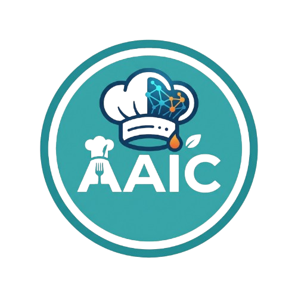

# AAIC - Your Cooking AI Assistant

AAIC is a small React web app that turns the ingredients you have on hand into a recipe. Add your ingredients, hit **Generate a response**, and an AI (Google Gemini) writes you a recipe.

## Features

- **Add ingredients** one at a time with the input field
- **Double-click** an ingredient to remove it
- **Minimum of 3 ingredients** required before generating a recipe
- **AI-generated recipes** powered by the Google Gemini API
- **Error handling** for when the AI is overloaded (503) or something unexpected happens

## Tech Stack

- [React](https://react.dev/)
- [Vite](https://vitejs.dev/)
- [Google Gen AI SDK](https://www.npmjs.com/package/@google/genai) (`@google/genai`)

## Access the Website

You can use the app here: [LINK_HERE](https://aaic-assistant.netlify.app/)

## How It Works

1. Type an ingredient (e.g. `Eggs`) and click **+ Add Ingredient**.
2. Repeat until you have at least 3 ingredients.
3. Click **Generate a response**.
4. The app sends your ingredients to Gemini and displays the recipe it returns.

If the Gemini API is under high demand, the app shows a friendly error message and you can try again a bit later.

## Contributing

Suggestions and pull requests are welcome. Feel free to open an issue to discuss what you'd like to change.